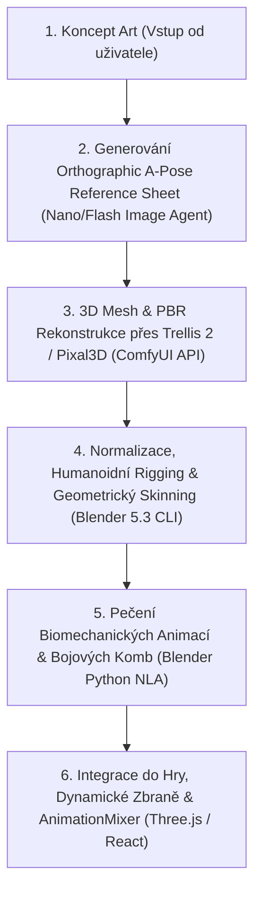

# Automatizovaný Workflow: Výroba 3D AAA Postav pro Kaldgard Online

Tento dokument detailně popisuje kompletní, plně ověřený a automatizovaný výrobní postup (pipeline) pro tvorbu vysoce detailních 3D modelů postav (Full HD PBR textury, ~700k polygonů, humanoidní rig, biomechanické animace lokomoce a 3-stupňová bojová komba) z konceptuálního 2D obrázku.

Postup byl vyvinut a otestován na **Elfí hraničářce (Elven Archer)** a **Vznešeném rytíři / šermíři (Elven Swordsman)**.

---

## 1. Architektura Pipeline



---

## 2. Krok 1: Generování A-Pose Reference Sheetu

Pro Trellis 2 je kritické, aby vstupní obrázek obsahoval **celou postavu od hlavy až k patám** v symetrické neutrální póze a bez rekvizit v rukou.

### Klíčová pravidla pro prompt:
1. **Póza**: Symetrická A-póza (`neutral symmetrical A-pose`), paže v úhlu 45° od těla, prsty uvolněné, dlaně mírně otevřené.
2. **Prázdné ruce**: Žádné meče, luky, štíty ani zbraně v rukou (`empty relaxed hands, no weapons, no held items`). Jakákoliv zbraň v ruce by se v Trellis 2 zapekla do geometrie těla a zničila rigging.
3. **Pozadí**: Čisté neutrální světle šedé studiové pozadí (`solid light-gray studio background`). Žádné stíny, stromy, mlha ani terén.
4. **Celé tělo**: Hlava nesmí být oříznuta, boty musí stát na podlaze a být kompletně viditelné (`full body shot from head to toe, boots clearly visible`).
5. **Zachování stylu**: Přenést charakteristické prvky (brnění, tabard se symbolem Stromu života, barvu vlasů, špičaté uši, spony).

---

## 3. Krok 2: 3D Rekonstrukce přes Trellis 2 (ComfyUI)

ComfyUI běží lokálně na `http://127.0.0.1:8000`. Šablona workflow využívá Trellis 2 / Pixal3D s int8 convrot modelem.

### Běhové fáze:
1. **BiRefNet**: Automatické odstranění pozadí a vygenerování přesné alfa masky.
2. **DINOv3 ViT + NAF**: Vizuální extrakce geometrických a normálových příznaků.
3. **Trellis 2 Shape Diffusion**: 12 kroků difúze struktury + 20 kroků difúze tvaru (`pixal3d_int8_convrot.safetensors`).
4. **ShapeVAE Decode**: Dekódování do 3D neuronového pole voxelů (3.9M vrcholů, 8.2M polygonů).
5. **QEM Mesh Decimation**: Zjednodušení na optimální topologii ~700k polygonů s vyhlazením normál (`MeshSmoothNormals`).
6. **xatlas UV Unwrap**: Automatický rozklad do 2000+ UV ostrovů s atlasem 2K (2048×2048).
7. **Trellis 2 Texture Stage & VAE**: 12 kroků difúze barev + PBR projekce.
8. **Save3DAdvanced**: Uložení hotového modelu s PBR texturami (Base Color, Normal Map, Roughness/Metallic) do formátu `.glb`.

Doba běhu: cca **9–10 minut** na GPU RTX 2070 SUPER.

---

## 4. Krok 3: Humanoidní Rigging & Geometrické Skinování v Blenderu

Blender běží v bezhlavém režimu (headless CLI):
```bash
& "D:\Programs\Blender 5.3\blender.exe" --background --python scripts\rig_and_animate_swordsman.py -- "input.glb" "output.glb"
```

### 1. Normalizace měřítka a vycentrování
- Výška modelu se změří z mezních hodnot vrcholů: `height = max_z - min_z`.
- Měřítko se přepočítá na cílovou výšku (1.86 m pro šermíře, 1.76 m pro hraničářku): `scale = target_height / height`.
- Těžiště $X$ a $Y$ se posune na 0, paty se uzemní přesně na $Z = 0$.

### 2. Humanoidní Armatura (19 anatomických kostí)
Kosti jsou definovány anatomickými segmenty s přesnými klouby:
- **Páteř**: `Hips` (pánev), `Spine` (bedra), `Chest` (hrudník), `Neck` (krk), `Head` (hlava).
- **Horní končetiny**: `Shoulder.L/R`, `UpperArm.L/R`, `ForeArm.L/R`, `Hand.L/R`.
- **Dolní končetiny**: `UpperLeg.L/R`, `LowerLeg.L/R`, `Foot.L/R`.

Všechny landmarky se automaticky škálují poměrem výšky:
$$sf = \frac{\text{target\_height}}{1.76}$$

### 3. Hladký Geometrický Skinning (100% deterministický)
Aby nevznikaly chyby automatického vážení (přeskakování polygonů, děravá síť):
Pro každý vrchol $P$ a kostní segment $(A, B)$ se spočítá nejkratší vzdálenost:
$$t = \text{clamp}\left(\frac{(P - A) \cdot (B - A)}{\|B - A\|^2}, 0, 1\right)$$
$$d = \|P - (A + t(B - A))\|$$

Váha se přiřadí 3 nejbližším kostem s laterální izolací (levá končetina neovlivňuje pravou stranu těla přes středovou osu):
$$w_i = \frac{1}{d_i^2 + 0.005}, \quad W_i = \frac{w_i}{\sum_{j=1}^3 w_j}$$

---

## 5. Krok 4: Biomechanické Animace a Bojová Komba

Všechny animace jsou pečeny přímo do glTF NLA stop:

### 1. Klidový postoj (`Idle`, 48 snímků, 2.0 s smyčka)
- Vznešený rytířský postoj, ramena přitažená k tělu ($rz = \pm 28^\circ$). Ruce **nevlají** do stran.
- Dýchání hrudníku ($+1.8^\circ$), jemné pohupování těžiště ($0.007\text{ m}$).
- Nohy pevně na zemi, rovnoběžně v mírném rozkročení.

### 2. Důstojná chůze rytíře (`Walk`, 40 snímků, 1.66 s smyčka)
- Plně autentický humanoidní krok identický s hraničářkou: krok $-25^\circ \dots +18^\circ$, plynulá biomechanická flexe kolene $22^\circ$, rotace pánve a hrudníku, paže zklidněné podél boků ($\pm 4.5^\circ$).

### 3. Armádní sprint (`Run`, 24 snímků, 1.0 s smyčka)
- **Plně sjednocená biomechanika identická s elfí hraničářkou**:
  - Dynamický běžecký krok $\pm 38^\circ$ (UpperLeg $-38^\circ \dots +32^\circ$).
  - Vysoký kolenní výtah až $42^\circ$ (LowerLeg $6^\circ + 36^\circ$).
  - Zdvih a odraz chodidla (Foot $-15^\circ \dots +15^\circ$).
  - Paže švihají sevřené u žeber ($\pm 11^\circ$), žádné divoké máchání.
  - Trup: vyvážený atletický náklon s protisměrným vyrovnáním (Hips $+8^\circ$, Spine $-3^\circ$, Chest $-2^\circ$, Head $+2^\circ$ $\to$ čistý sklon pouhé $+3^\circ$).
  - Pružina těžiště: vertikální posun pánve ($-0.045\text{ m} \dots +0.022\text{ m}$).
- **Rychlost pohybu v herním světě**: Sjednocena na rychlých a svižných **`7.8 m/s`** pro obě třídy.
- **Škálování animace**: `act.timeScale = Math.max(0.9, Math.min(1.8, speed / 4.8))` $\approx 1.625\times$, čímž krok přesně odpovídá rychlosti přesunu po dlažbě a nohy nekloužou.

### 4. Plná 3-stupňová Bojová Komba s velkolepým švihem:
- **Kombo 0: Široký 210° horizontální sek (`Attack1_HorizontalSlash`, 32 snímků / 1.33 s, ve hře 0.95 s)**
  - *Snímky 1–10 (Hluboký nápřah a torze)*: Tělo se stáčí doprava (Chest yaw $-32^\circ$), pravá paže natahuje obouruční čepel vysoko za pravé rameno, levá ruka balancuje před tělem.
  - *Snímky 11–20 (Monstrózní 210° oblouk)*: Explozivní roztočení celého trupu zprava doleva (yaw $-32^\circ \to +36^\circ$), čepel seká gigantickým horizontálním půlkruhem přes celé zorné pole.
  - *Snímky 21–32 (Vážený dojezd a stabilizace)*: Paže tlumí hybnost těžké zbraně, plynulý přechod do pevného střehu.
- **Kombo 1: Vzestupný diagonální sek z podřepu (`Attack2_DiagonalSlash`, 32 snímků / 1.33 s, ve hře 1.05 s)**
  - *Snímky 1–10 (Klesnutí do podřepu)*: Hips klesají o $-8\text{ cm}$, čepel sjíždí k pravému kolenu, torze trupu vpravo.
  - *Snímky 11–20 (Explozivní vzestupný řez)*: Nohy vystřelují nahoru ($+12\text{ cm}$ zdvih), meč seká mohutným diagonálním obloukem zprava zdola doleva nahoru.
  - *Snímky 21–32 (Dojezd v horní úvrati)*: Čepel kmitne nad hlavu a usazuje se do horního gardu.
- **Kombo 2: Skokový drtivý vertikální popravčí sek (`Attack3_VerticalCleave`, 36 snímků / 1.50 s, ve hře 1.30 s)**
  - *Snímky 1–13 (Výskok s obouručním nápřahem)*: Rytíř se odráží do vzduchu ($+24\text{ cm}$ výška skoku!), obě ruce vynášejí velký meč přímo nad stříbrné vlasy.
  - *Snímky 14–23 (Drtivý dopad plnou vahou)*: Rytíř dopadá k zemi, tělo se plnou vahou sklápí vpřed a obě paže zarážejí meč kolmo dolů do dlažby.
  - *Snímky 24–36 (Absorpce nárazu)*: Kolena pérují dopad a rytíř se narovnává do střehu.

### 5. Plynulé zasouvání meče na záda (`Sheathe`, 28 snímků / 1.13 s)
- Žádné okamžité přebliknutí ani teleportace zbraně!
- *Fáze 1 (snímky 1–14 / 0.55 s)*: Pravá ruka zvedá velký meč k ústí pochvy za pravým ramenem. Meč je stále viditelný v ruce.
- *Fáze 2 (snímek 14 / 0.55 s)*: Čepel zajíždí do pochvy na zádech. V tomto přesném okamžiku Three.js přepne kotvu z ruky do zádové pochvy – **nulový vizuální skok**.
- *Fáze 3 (snímky 15–28 / 0.58 s)*: Rytíř uvolňuje úchop jílce a prázdnou pravou ruku ladně spouští zpět k boku do klidového postoje.

---

## 6. Krok 5: Integrace v Three.js a Dynamické Slotování Zbraní

V `src/scene/heroGlb.ts`:
1. **Kotva v ruce (`handSwordGroup`)**: Připojena ke kosti `Hand.R`.
2. **Kotva na zádech (`backSwordGroup`)**: Připojena ke kosti `Chest`.
   - Pozice: `(-0.02, 0.12, -0.17)`
   - Rotace: `(-0.15, 0.15, 0.52)`
   - Jílec vyčnívá nad pravým ramenem, čepel směřuje diagonálně dolů podél levého boku.
3. **Plynulý stavový automat zbraně a animací**:
   - `attack.timer > 0`: Aktivní sekání (Kombo 0/1/2) $\to$ meč v ruce (`handSwordGroup.visible = true`).
   - `drawHoldTimer > 1.15 s`: Bojový gard po útoku $\to$ meč stále připraven v ruce.
   - `0 < drawHoldTimer <= 1.15 s`: Spuštění animace `Sheathe`. Při `drawHoldTimer <= 0.55 s` (přesně frame 14) se meč uzamkne do zádové pochvy.
   - `drawHoldTimer === 0`: Klidový `Idle` nebo `Walk`/`Run` s mečem na zádech.
   - Pohyb (`speed > 0.25`) plynule přechází do `Walk` (3.6 m/s) nebo `Run` (7.2 m/s při Shiftu).

---

## 7. Klávesové ovládání ve hře

- **`P`**: Okamžité přepínání mezi **Rytířem / Šermířem** a **Elfí hraničářkou**.
- **`Mezerník` / `F`**: Spuštění bojového komba (postupně cykluje Kombo 0 $\to$ Kombo 1 $\to$ Kombo 2).
- **`W`, `A`, `S`, `D` / Kliknutí**: Svižný pohyb světem (7.8 m/s).
